# Geração de Histórias em Quadrinhos — Image & Sprite Lab

**AI Creative Hub — bridges multimodais, comandos e produção visual rastreável**

[Roteador mestre](ROUTER-MESTRE.md) · [Catálogo](templates/CATALOGO.md) · [Regras](regras/00-LEIA-PRIMEIRO.md) · [Instruções do Projeto ChatGPT](configuracao-projeto-prompt-instrucao/PROMPT-PROJETO.md)

## Fluxo de criação

[Ver versão estática do fluxo (SVG)](docs/fluxo-criacao-historia.svg)

O fluxo acima vale para ChatGPT e agentes. A cópia individual do roteiro no GitHub é opcional; a consulta à fonte narrativa e às regras atuais antes da geração é obrigatória.

## Como começar

1. Leia [`ROUTER-MESTRE.md`](ROUTER-MESTRE.md).
2. Consulte o [índice de comandos](commands/COMMAND-INDEX.md) e o [manual](commands/COMMAND-MANUAL.md).
3. Identifique a bridge e o workflow apropriados.
4. Para histórias bíblicas, consulte [`templates/CATALOGO.md`](templates/CATALOGO.md), o template e a fonte narrativa canônica.
5. Consulte o [registro de skills](external/SKILL-REGISTRY.md) e valide provider, versão e disponibilidade antes da execução.
6. Gere o ativo, valide-o e registre apenas estados confirmados.

## Template universal

[`TPL-MOCKUP-UNIVERSAL`](templates/mockup-template.md) — mockup de história com balões de fala, caixas retangulares de narração e layout adaptável.

**Direção visual aprovada:** padrão horizontal 16:9 (mínimo 1920 × 1080) e variante vertical 9:16 (mínimo 1080 × 1920, somente se solicitada). Os dois modelos estão juntos na pasta `mockups/`.

## Convenção universal das fontes

As narrativas de coleção ficam em `historias/historias-<nome-colecao>.md`. O status de produção pode ser registrado em `historias/status-criacao-historia.<nome-colecao>.md`. Consulte sempre a árvore e o conteúdo atuais do GitHub.

Copiar um roteiro individual para `historias/` é opcional: facilita o rastreio, mas não é obrigatório para gerar a imagem. Se o usuário fornecer um arquivo Markdown, ele pode ser usado como roteiro da tarefa. Atualize o manifesto quando o estado de produção mudar e houver acesso autorizado; registre apenas fatos confirmados.

Arquivos canônicos presentes:
- [`historias/historias-novo-testamento.md`](historias/historias-novo-testamento.md)
- [`historias/status-criacao-historia.novo-testamento.md`](historias/status-criacao-historia.novo-testamento.md)
- [`historias/historias-antigo-testamento.md`](historias/historias-antigo-testamento.md)
- [`historias/status-criacao-historia.antigo-testamento.md`](historias/status-criacao-historia.antigo-testamento.md)

## Estrutura documental

| Caminho | Função |
|---|---|
| [`ROUTER-MESTRE.md`](ROUTER-MESTRE.md) | Ponto de entrada estável |
| [`regras/00-LEIA-PRIMEIRO.md`](regras/00-LEIA-PRIMEIRO.md) | Ordem de consulta |
| [`templates/CATALOGO.md`](templates/CATALOGO.md) | IDs disponíveis |
| [`templates/mockup-template.md`](templates/mockup-template.md) | Template de mockup universal |
| [`mockups/mockup-template-universal.svg`](mockups/mockup-template-universal.svg) | Modelo principal 16:9, 1920 × 1080 |
| [`mockups/mockup-template-universal-9x16.svg`](mockups/mockup-template-universal-9x16.svg) | Variante 9:16, 1080 × 1920; somente sob solicitação |
| [`templates/status-criacao-historia.template.md`](templates/status-criacao-historia.template.md) | Esquema dos manifestos |
| [`regras/ROTA-GERAL.md`](regras/ROTA-GERAL.md) | Fluxo operacional |
| [`regras/SKILLS-E-RECURSOS.md`](regras/SKILLS-E-RECURSOS.md) | Skills e recursos complementares |
| [`regras/PADRAO-VISUAL-E-COMPOSICAO.md`](regras/PADRAO-VISUAL-E-COMPOSICAO.md) | Direção visual e tipografia |
| [`regras/VALIDACAO-FINAL.md`](regras/VALIDACAO-FINAL.md) | Checklist de validação |
| [`commands/COMMAND-INDEX.md`](commands/COMMAND-INDEX.md) | Catálogo de comandos multimodais |
| [`commands/COMMAND-MANUAL.md`](commands/COMMAND-MANUAL.md) | Sintaxe e utilização dos comandos |
| [`commands/COMMAND-CONTRACT.md`](commands/COMMAND-CONTRACT.md) | Contrato do roteador de comandos |
| [`external/SKILL-REGISTRY.md`](external/SKILL-REGISTRY.md) | Procedência e governança de skills |
| [`docs/AI-CREATIVE-HUB-ARCHITECTURE.md`](docs/AI-CREATIVE-HUB-ARCHITECTURE.md) | Arquitetura-alvo multimodal |
| [`configuracao-projeto-prompt-instrucao/PROMPT-PROJETO.md`](configuracao-projeto-prompt-instrucao/PROMPT-PROJETO.md) | Instruções internas do Projeto ChatGPT |

## Idioma e ortografia

Todo texto editorial deve usar **português brasileiro (pt-BR)**: títulos, falas, narração, legendas, instruções, documentação e relatórios. Revisar ortografia, acentuação, pontuação, concordância e legibilidade antes de aprovar.

## AI Creative Hub

A arquitetura-alvo organiza seis bridges: **Image, Comic, Video, Voice, Audio e Sprite**. Os comandos são documentados em [`commands/COMMAND-INDEX.md`](commands/COMMAND-INDEX.md); os contratos e exemplos estão no [manual](commands/COMMAND-MANUAL.md) e no [Command Router Contract](commands/COMMAND-CONTRACT.md). A visão arquitetural está em [`docs/AI-CREATIVE-HUB-ARCHITECTURE.md`](docs/AI-CREATIVE-HUB-ARCHITECTURE.md).

**Importante:** os comandos estão especificados documentalmente, mas ainda não há parser/dispatcher de slash commands implementado neste repositório. A documentação não registra comandos automaticamente em ChatGPT ou outros hosts.

### Skills e providers

A pasta `.agents/skills/` já contém skills locais da Higgsfield. Não duplicar esses conteúdos. Consultar o [registro de skills](external/SKILL-REGISTRY.md) para procedência, escopo e política de adoção. Skills externas devem ser referenciadas ou adaptadas após auditoria de licença, dependências e segurança.

A skill [Higgsfield Generate](https://github.com/higgsfield-ai/skills/blob/main/higgsfield-generate/SKILL.md) documenta recursos de imagem, vídeo, 3D e áudio via CLI, mas não comprova que CLI, conta ou provider estejam disponíveis. Para histórias bíblicas, prevalece a ferramenta principal definida no guia operacional atual. Voice/TTS requer provider especializado homologado.

## Integridade

Não inventar fontes, imagens salvas, status ou resultados. Uma imagem exibida no chat não prova que foi salva no GitHub. Não marcar um ativo aprovado sem inspeção real e validação do usuário quando requerida.

## Cópias locais de skills

A pasta `.agents/skills/` contém arquivos locais de apoio e pode ficar defasada. Para qualquer produção, consulte primeiro a versão atual publicada no repositório oficial indicado em `regras/SKILLS-E-RECURSOS.md`. Não trate a cópia local como autoridade de versão e não declare uma ferramenta operacional apenas pela presença de arquivos locais.
